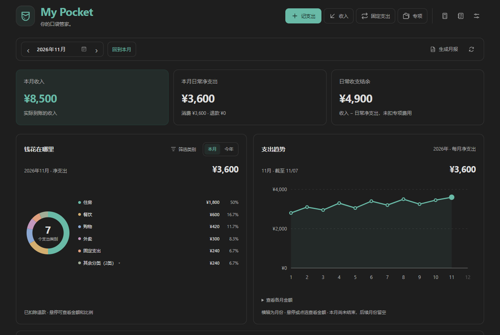
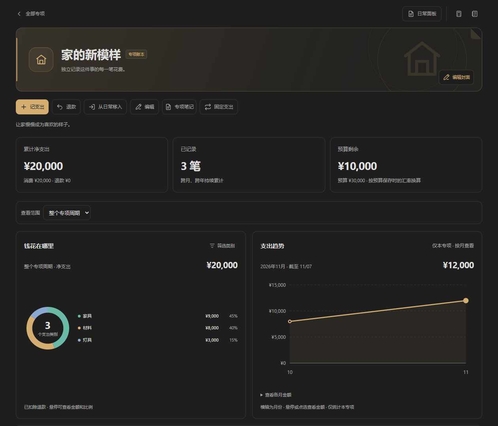
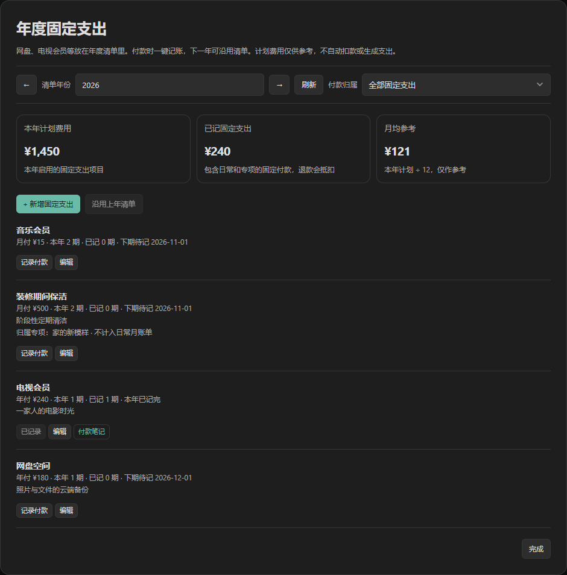
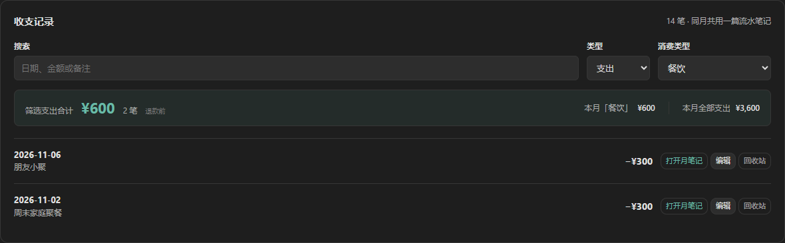
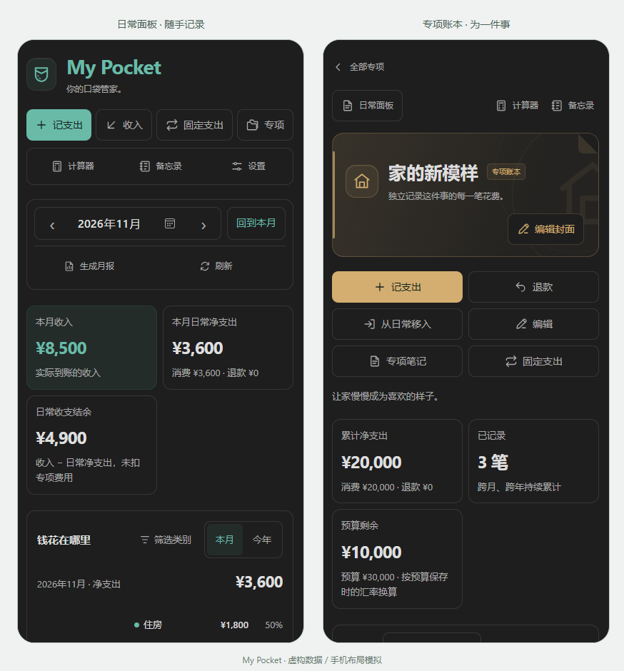
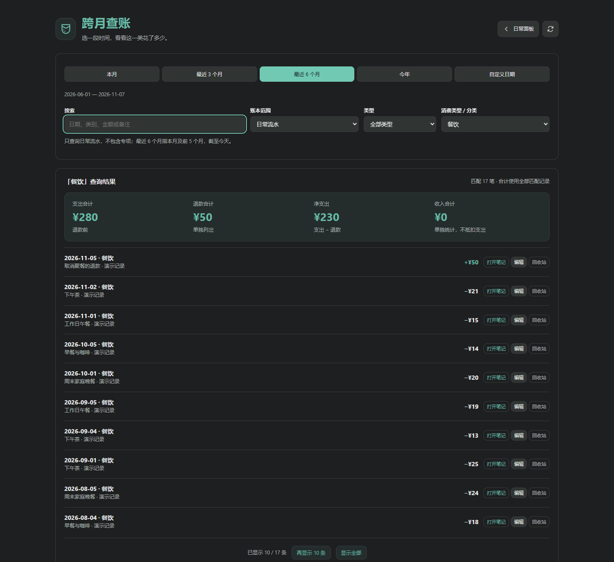
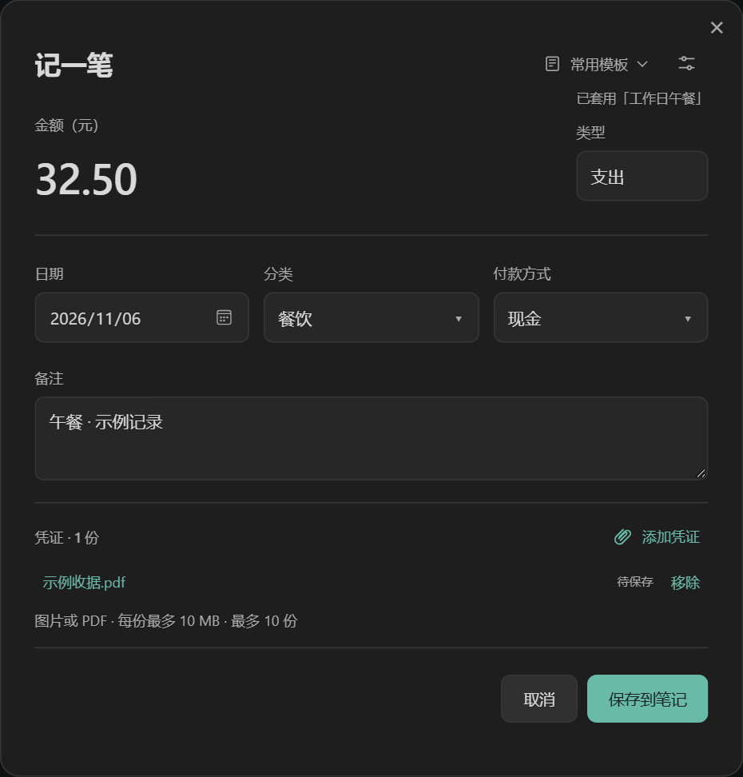
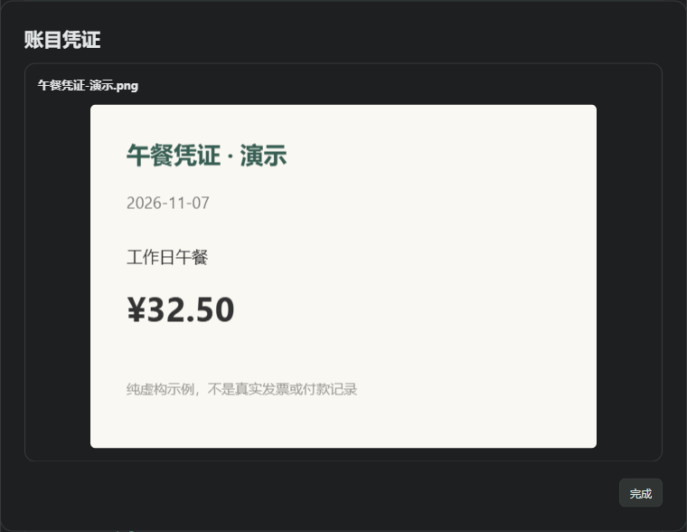

# My Pocket

**你的口袋管家。**

把日常开销、为一件事投入的费用，以及每年要续费的项目，清楚地记在自己的 Obsidian 里。

MyPocket 是一款本地 Markdown 财务插件。电脑上整理，手机上随手记；即使停用插件，账目依然是你能打开、阅读和备份的笔记。

**Zoe Qian · 1.0.0 · 电脑与手机共用 · 无需 Dataview**

当前发布采用 **PolyForm Strict License 1.0.0**；允许的使用范围见本页末尾的[许可与版权](#13-许可与版权)。

> 本页所有金额、项目和截图均为虚构演示数据。手机图片来自浏览器触摸与窄屏模拟，用来展示布局，不代表真实手机截图。指南随插件离线提供；下面的同步服务文档链接需要联网打开。



从这里开始：[第一次记账](#1-第一次记账) · [理解三种记录](#2-日常专项与固定支出) · [专项账本](#3-为一件事建立专项) · [固定费用](#4-把固定费用安排清楚) · [手机使用](#6-在手机上使用) · [多设备同步](#7-电脑与手机同步) · [恢复记录](#8-删除恢复与同步冲突) · [跨月查账](#10-跨月查账看清一段时间的花费) · [常用模板](#11-常用模板让重复记账更快) · [本地凭证](#12-给账目附上本地凭证)

## 1 第一次记账

### 安装与打开

1. 下载 MyPocket 安装包，解压后找到 `local-finance-notes` 文件夹。
2. 把该文件夹放到目标 Obsidian 库的 `.obsidian/plugins/` 下。里面应直接包含 `main.js`、`manifest.json` 和 `styles.css`，不要再多套一层文件夹。
3. 在 Obsidian「设置 → 第三方插件」中启用 **MyPocket**。更新后，保存当前工作，再关闭并重新开启插件。
4. 点击 Obsidian 左侧的钱包图标，或在命令面板搜索 **MyPocket → 打开财务面板**。

使用指南可以从面板底部、个性化设置或命令面板的 **「打开使用指南」** 再次打开。它已包含在安装包中，不需要额外复制说明文档。

在插件内点按示意图可以查看大图；选择「原始尺寸」后，可滚动查看细节。

### 记下一笔午餐

1. 点 **「记支出」**，输入实际金额，例如 `32.50`。
2. 选择日期和分类，例如「餐饮」。也可以输入自己的分类。
3. 按需填写付款方式和备注，例如「午餐」。
4. 点 **「保存到笔记」**。统计随即更新；最近记录中，同一天后记的账目排在前面。

默认使用人民币。**界面显示整数，笔记保留实际精度**：32.50 元显示为 ¥33；汇总先使用实际金额相加，再取整。因此，逐条显示值相加可能与合计略有差异。

列表默认显示最近 **10 条**。点「显示全部」展开；无论列表展开与否，汇总始终计算全部匹配记录。

## 2 日常、专项与固定支出

记账前，先想清楚这笔钱属于哪里：

| 你的问题 | 使用什么 | 如何参与统计 |
| --- | --- | --- |
| 这个月平时花了多少钱？ | **日常支出**：吃饭、交通、日用品等 | 进入月流水、日常图表和月报 |
| 为装修、旅行或健身累计花了多少？ | **专项账本**：围绕一件事独立记录 | 跨月、跨年累计，不进入日常月账单 |
| 网盘、会员等什么时候续费？ | **固定支出清单**：年付或月付计划 | 计划本身不记支出，确认付款后才进入选定的日常或专项 |

**专项是独立账本；固定支出是一种安排付款的方式。** 固定费用可以属于日常，也可以属于某个专项，两者不会重复记账。

例如，11 月日常支出 **3,600 元**，其中包含已支付的电视会员 **240 元**；装修专项当月花费 **12,000 元**：

- 日常面板与日常月报：**3,600 元**。
- 专项概览的当月专项净支出：**12,000 元**。
- 专项概览的当月全部实际支出：**15,600 元**。
- 电视会员已经包含在 3,600 元里，不再额外加一次。

以上假设没有退款。实际统计中的**净支出＝消费支出－退款**；收入减日常净支出得到的结余，也不等于银行卡余额。

## 3 为一件事建立专项



1. 在日常面板点 **「专项」→「新建专项」**，填写名称，例如「家的新模样」。
2. 可以选填预算、开始日期、分类和说明。每个专项还能选择图标与柔和配色，做成自己的小册子封面。
3. 进入专项后点 **「记支出」**。这些费用只写入该专项，不会挤高日常月度消费。
4. 用 **「退款」** 记录退回的金额；用查看范围选择整个周期、某年或某月。

示例中的装修专项累计已花 **20,000 元**，预算 **30,000 元**，剩余 **10,000 元**。预算只是参考，不会自动生成支出；累计金额可以包含其他月份，所以不一定等于“本月专项支出”。

在「钱花在哪里」中多选类别，分类占比、趋势和专项明细会一起更新。专项记录还可以按支出／退款、消费类型及搜索词筛选，汇总同步变化。

**之前记在日常里的费用也能整理进来。** 点「从日常移入」，筛选、选择、预览后确认。记错方向时，在某条专项记录旁点「移到日常」，这笔费用会进入其日期对应的月流水。移动保留原金额与 ID，不会复制记两笔；相关月报更新时保留手写复盘。

每个专项共用一篇 `专项/名称.md`，可以持续跨年使用。名称不能重复，已归档专项也保留名称。结束一个专项时，编辑并设为「已归档」即可保留历史统计；以后可重新启用。

点 **「专项笔记」**，可以在表格下写合同说明、行程、双链或凭证。封面右下角的「编辑封面」只调整外观。

## 4 把固定费用安排清楚



### 第一步：保存计划

点 **「固定支出」→「新增固定支出」**，填写名称、年付／月付、每次金额、首次付款或续费日期，以及付款归属。

- **日常费用**：电视会员、网盘等，归属选择「日常支出」。
- **专项费用**：例如装修期间的定期保洁，归属选择该专项。从专项页面进入固定支出时，会带上当前专项，新增时也会预选它。

这一步只生成清单，不会自动扣款，也不会增加已花金额。

### 第二步：真正付款后确认

实际付费后点该项目的 **「记录付款」**，确认对应期次、实际日期和金额，再保存。

例如电视会员计划 240 元、实际优惠后支付 220 元：清单仍保留参考价格，流水记录实际的 220 元。同一期已经记过时，插件会阻止再次添加。

如果你已通过普通「记支出」手工记过同一付款，不要再重复确认；插件不能仅凭相同金额猜测两条不同 ID 的记录是不是同一笔。

### 第三步：看懂计划与实际

| 数字 | 含义 |
| --- | --- |
| 本年计划费用 | 当前启用项目的计划合计；专项筛选时只看该专项 |
| 已记固定支出 | 已确认付款，以及手工记为「固定支出」的记录；退款抵扣，按所选查看范围统计 |
| 月均参考 | 本年计划除以 12，方便理解年费，不生成摊销流水 |

停用项目会退出当前启用计划，但已经发生的付款仍保留。下一年可以「沿用上年清单」，再核对价格和续费日；不会复制上一年的付款记录。月付从首次月份排到年底，月底遇到短月按该月最后一天处理。

固定清单目前用于**支出计划**，工资等收入可在到账时通过「收入」手工记录。实际付款日期须在清单所属年份内，暂不支持把下一年度期次提前记在上一年。

## 5 看图、找记录、写复盘

- **钱花在哪里**：切换本月／今年，多选类别，只看自己关心的开销。右侧支出趋势同步使用这些类别。
- **收支记录**：选择「支出」后可以继续选择消费类型。搜索和类型筛选同时作用，下方显示匹配金额与笔数。
- **日常图表与专项图表**：各自统计自己的账本。日常图表筛选不会修改记录，也不会改变完整月报。
- **生成月报**：把当月日常统计保存为笔记；在「我的月度复盘」中写感受，再次生成保留这部分文字。



个性化设置可以管理分类、付款方式，或隐藏收入、理财、专项入口。支出始终保留，关闭其他入口不会删除已有账目。计算器适合临时加减乘除；备忘录适合账期、剪发卡或课程剩余次数，会独立保存成 `备忘录.md`。

需要美元、日元时，在 **「个性化设置 → 货币设置」** 开启多币种，选择默认记账币种和汇总币种。每笔外币记录保存原币金额与参考汇率；离线时可用缓存或手工填写。缺少所需汇率时，相关合计会标为“待补全”。默认人民币记账无需访问汇率服务，已有记录的汇率快照不会随刷新静默重算。

## 6 在手机上使用



电脑与手机使用**同一份安装包**。在安卓 Obsidian 中打开笔记库，将插件同步过去或手动放入 `.obsidian/plugins/local-finance-notes/`，然后在第三方插件中启用。

手机可以记账、选择分类、查看图表、管理专项与固定支出、使用计算器和备忘录。工具按钮会显示短标签，趋势图可以点选月份，表单会适配触摸和窄屏。

常用打开方式是命令面板中的 **MyPocket → 打开财务面板**。首次使用请核对「设置 → MyPocket → 数据目录」与电脑一致。

移动布局已做浏览器模拟检查；真实安卓软键盘、设备文件权限和同步连接仍需在你的手机上确认。iPhone 使用同一代码包，但尚未经 iOS 真机验证。

## 7 电脑与手机同步

### 先分清同步的对象

| 对象 | 默认位置 | 是否需要 |
| --- | --- | --- |
| 你的账目 | `财务管理/流水数据/` | 必须同步，或完整复制过去 |
| 插件程序 | `.obsidian/plugins/local-finance-notes/` 中的三个安装文件 | 每台设备都要有；可以单独安装，也可以同步 |
| 分类和界面偏好 | 同一插件目录下的 `data.json` | 按需同步；不要公开上传 |

只同步了笔记，不代表插件也已经安装；只同步了插件，也不代表旧账本已经传过去。若使用自定义数据目录或配置文件夹，请以你自己的路径为准。

### 方案 A：Remotely Save

1. 每台设备先安装并配置 Remotely Save，连接同一个远程空间；核对远程目录。启用加密时，两端使用相同密码。
2. 先让主电脑完成同步，再让另一台设备下载。确认 `财务管理/流水数据/` 没有被排除。
3. 若希望连插件一起同步，在 Remotely Save 设置中开启**同步配置文件夹**。它默认不包含 `.obsidian`；官方将这一选项标为实验性质，开启前先备份，它也会涉及其他插件和 Obsidian 设置。
4. 下载完成后，重新加载 Obsidian 或 MyPocket，确认插件已启用、数据目录一致，再记下一笔。

如果希望两台设备各自保留插件设置，也可以只同步流水数据，分别手动安装 MyPocket。配置选项与限制以 [Remotely Save 官方说明](https://github.com/remotely-save/remotely-save#config-folder--files-and-bookmarks) 为准。

### 方案 B：Obsidian Sync

Obsidian Sync 是需要订阅的官方同步服务。在电脑开启核心插件 **Sync**、创建远程库，再在另一台电脑或手机连接同一个远程库。具体登录与连接步骤可参考 [官方设置教程](https://obsidian.md/help/sync/setup)。

在**每台设备**的「设置 → Sync」中：

1. 确认流水数据文件夹没有被排除。
2. 想一起同步插件时，在库配置同步中开启 **Installed community plugin list**（已安装第三方插件）与 **Active community plugin list**（已启用第三方插件）。
3. 等待下载完成，重新加载应用，再检查 MyPocket 与个人设置。同步选项本身需要逐台配置。

选项名称可能随语言或版本略有变化，参见 [官方同步范围说明](https://obsidian.md/help/sync/settings)。MyPocket 即使尚未进入社区市场，也可以先手动安装，再按这些选项同步已安装的插件文件。

### 每次换设备的习惯

**设备 A 保存 → A 同步完成 → 设备 B 同步完成 → B 开始记账。**

同月共用一篇流水笔记，因此尽量避免两台设备离线时同时编辑同一个月。同步后可用同一月份的合计和最新一条记录做核对。两种同步方案选一种即可，避免多个服务同时处理同一库；同步也不能替代独立备份。[Obsidian 的跨设备同步建议](https://obsidian.md/help/sync-notes)

## 8 删除、恢复与同步冲突

记录旁的「回收站」会把日常或专项流水移到 MyPocket 的回收站，而不是直接抹掉金额。误删后，进入 **「个性化设置 → 数据恢复」** 查看记录，核对金额、备注和恢复位置，再确认恢复。

同一 ID 已经存在于有效账本时，插件会阻止重复恢复；专项已归档时，需要先重新启用。理财笔记的整篇删除走 Obsidian 的文件回收机制，不在流水恢复列表中。

同步中断或复制笔记后，如果发现重复 ID，进入数据恢复里的**重复记录**：先比较各版本的日期、金额、备注和位置，再选择保留哪一份。其余支持处理的流水版本会进入回收站，不直接丢弃。它不是按“相同金额”去重，也不会擅自决定哪一份才正确。

遇到格式错误、重复专项 ID 或不支持自动处理的笔记时，按照提示打开对应笔记检查；不要反复点击移动来尝试消除警告。

## 9 数据始终在自己的笔记库

```text
财务管理/
├── 流水数据/
│   ├── 流水/2026/2026-11.md   每月日常收支
│   ├── 专项/家的新模样.md     一个专项，一篇笔记
│   ├── 固定支出/2026.md       年度计划清单
│   ├── 理财/                 持仓笔记
│   ├── 月报/2026/2026-11.md   日常复盘
│   ├── 备忘录.md             独立文字记录
│   ├── 常用模板.md           日常和专项的记账模板
│   ├── 凭证/YYYY/MM/         本地图片与 PDF
│   └── 回收站/               已删除的流水
└── 应用安装包/               安装文件与说明
```

年份目录按记录日期创建，跨年无需重新建库。月流水和专项笔记的表格外可以自由写内容；编辑记录会保留这些文字。手工修改表格时，请保留表头、ID 与定位注释；跨月改日期或调整外币金额，优先使用面板的「编辑」。

安装到其他库不会自动搬走你的旧数据。需要接着使用旧账本时，应完整复制或同步流水数据目录，再核对插件的数据目录设置。更改设置只会切换读取位置，不自动移动笔记。

## 10 跨月查账，看清一段时间的花费



想知道「最近半年餐饮一共花了多少」，不需要逐月打开笔记。点击日常面板收支记录标题旁的 **「跨月查账」**，会在独立页面中打开查询，带上当前的类型、分类与搜索条件。

1. 选「最近 6 个月」，也可切换本月、最近 3 个月、今年或自定义开始 / 结束日期。
2. 账本范围选择「日常流水」，分类选择「餐饮」。如只看实际支出，类型选择「支出」；如需要扣除退款，选择「全部类型」。
3. 查看筛选合计与匹配笔数。搜索日期、分类、金额或备注，会同步缩小记录和合计范围。

「最近 6 个月」指**本月及前 5 个月，截至今天**。例如 2026 年 11 月 7 日查询，对应 2026 年 6 月 1 日至 11 月 7 日；不是从今天倒推 180 天。自定义范围包含起止日期，未来记录不计入实际花费。

「全部类型」下分别显示支出、退款和净支出；收入开启时单独列出，不拿收入抵扣消费。只选「支出」时展示退款前支出合计，只选「退款」或「收入」则展示对应合计。缺少汇率的金额显示「待补全」，避免把不完整结果当成总额。

账本范围还可以选 **「全部专项」** 或一个具体专项，已归档专项的历史花费也可以查询。日常和专项分别查询，专项金额不会因此混入日常月账单。

明细先显示最近 10 条，可点击「再显示 10 条」或「显示全部」。合计始终计算全部匹配记录。打开笔记、编辑或移至回收站继续使用原记录；查询本身不会生成另一份账本，也不会改变记录归属。已归档专项仅供查阅，需要修改时先重新启用该专项。

## 11 常用模板，让重复记账更快



在新建账目的窗口顶部点击「常用模板」，展开后选择一个模板，即可填入类型、分类、付款方式、金额和备注，面板会自动收起。模板金额也可以留空，适合每次价格不同的午餐或通勤。

1. 首次填写一笔常见消费后，展开 **「常用模板」→「存为模板」**，为它起个名字，例如「工作日午餐」。只保存模板，不会同时记账。
2. 下次新建账目，选择这个模板，再核对金额和日期，最后点击「保存到笔记」。
3. 在 **「个性化设置 → 常用模板」** 中可新建、编辑或删除模板，也可展开记账窗口的「常用模板」，点「管理模板」。

日常和每个专项各有自己的模板。选择模板会保留表单当前日期与已选凭证，不复制旧账的日期、编号或汇率，也不会自动保存。外币模板需先开启多币种；每次记账重新确定所需汇率。

模板保存为数据目录中的 **`常用模板.md`**，可随流水数据同步。删除模板不会删除使用它记过的账。

## 12 给账目附上本地凭证

在日常、专项的记账或编辑窗口，以及固定支出的「记录付款」窗口，点击 **「添加凭证」**。可以选择付款截图、收据图片或 PDF，支持一次选择多份。



- 支持 PNG、JPG/JPEG、WebP、GIF 和 PDF；每笔最多 **10 份**，每份不超过 **10 MB**。
- 选择后可以预览或移除。只有保存账目时，文件才会复制进本地的 `凭证/YYYY/MM/`；取消表单不会导入文件。
- 保存后，记录旁会出现 **「凭证 1」** 等入口。图片直接预览，PDF 可点「打开原文件」。月流水和专项笔记中也会保留可点击的凭证链接。
- 账目跨月、在日常与专项之间移动、移入回收站或恢复时，凭证关联会一起保留。移除关联不会自动删除原文件，便于恢复历史记录；插件不做自动清理。

凭证原文件由你选择并保存在本地，不做云端识别。多设备使用时，除了 Markdown，也要同步**凭证文件夹及其中的图片、PDF**；留意同步服务的单文件大小限制。若另一设备提示文件尚未同步，请等待附件下载完成，再打开凭证，账目金额仍可正常查看。

## 13 许可与版权

Copyright (c) 2026 **Zoe Qian**。

当前发布使用 **PolyForm Strict License 1.0.0**，属于源码可见的受限许可。允许非商业用途及条款列明的机构用途；不授予自行分发、修改插件程序或制作衍生作品的权限。超出条款的用途需另行授权，法律规定的例外仍适用。

在许可允许的用途内，个人可以在自己的设备上安装、备份和同步插件用于记账。你自行创建的流水、凭证、模板等数据不适用插件许可，仍可自行编辑、导出和备份。这些正常使用权限不等于向他人再分发插件的授权。

本页为中文说明，不替代完整条款。[许可全文](https://github.com/ZoePiQian/mypocket/blob/main/LICENSE)与[版权说明](https://github.com/ZoePiQian/mypocket/blob/main/NOTICE)可在官方仓库查阅，打开链接需要联网。

1.0.0 曾以 MIT 发布；此次更换许可和重新发布不追溯撤回已经有效授出的旧授权。GitHub 平台条款授予的查看、fork 等权限仍适用。

**从一笔支出开始，把记账留在你每天使用的笔记里。**
