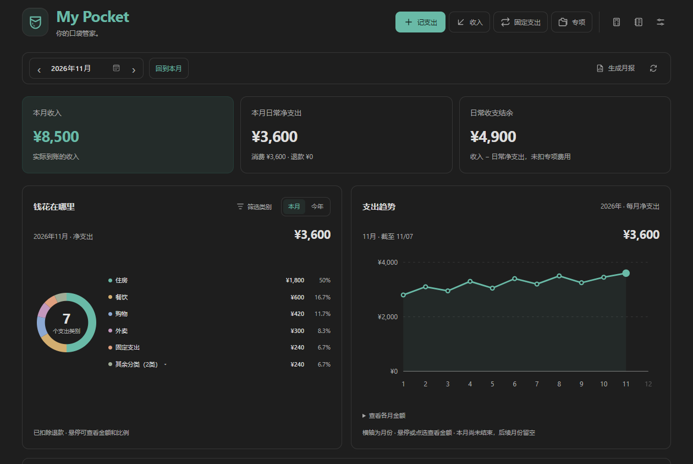
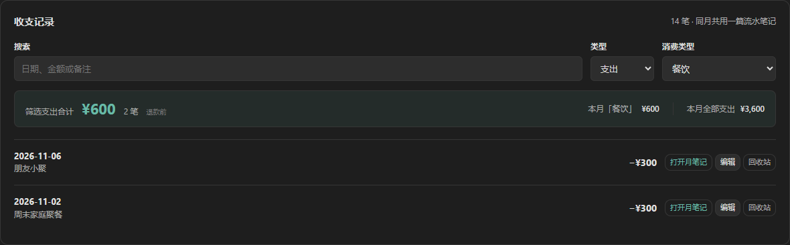
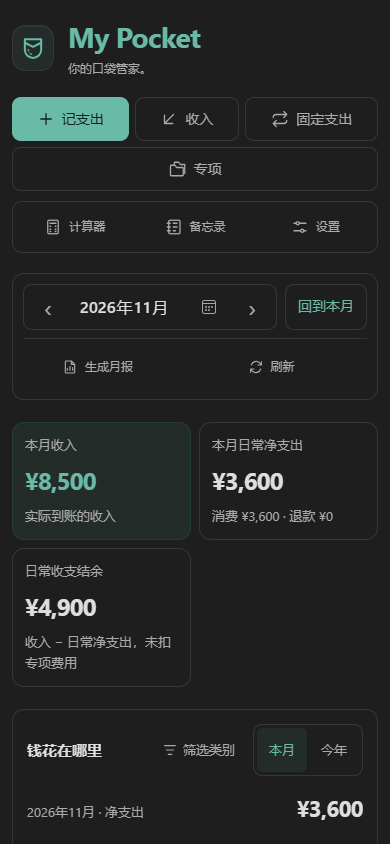

# My Pocket

**你的口袋管家。**

MyPocket 是一款把财务数据保存在本地 Markdown 笔记中的 Obsidian 插件。随手记录日常开销，为装修、旅行或健身建立独立专项，再用清晰的图表看懂自己的消费。

作者 **Zoe Qian** · 代码版本 **1.0.1** · 电脑与手机共用 · 无需 Dataview 等额外插件

当前发布采用 **[PolyForm Strict License 1.0.0](LICENSE)**。允许条款规定的非商业等用途；不授予修改插件、制作衍生作品或自行再分发的权限。源码可见，属于受限许可。详见[许可与版权](#许可与版权)。

**[阅读图文使用指南 →](INTRODUCTION.md)** 从第一次记账、专项与固定费用，到手机使用、多设备同步和误删恢复。安装后也可在面板底部、个性化设置或命令面板中打开「使用指南」；文字与配图已包含在插件中，可以离线阅读。

## Overview (English)

MyPocket is an Obsidian plugin by **Zoe Qian** for recording expenses, income and refunds in local Markdown notes. Keep everyday spending separate from project ledgers, track recurring expense plans, and review category charts and monthly reports. Plans become expenses only when you record a payment. The interface and the [full illustrated guide](INTRODUCTION.md) are in Chinese; the guide is also available offline inside the plugin. No Dataview or other companion plugin is required.

## Installation

1. Download and extract the [MyPocket 1.0.1 manual installation package](MyPocket-1.0.1.zip), or use the repository's `安装文件/local-finance-notes/` folder.
2. Copy `local-finance-notes` into your vault's `.obsidian/plugins/` folder. It must directly contain `main.js`, `manifest.json` and `styles.css`.
3. Reload Obsidian and enable **MyPocket** under **Settings → Community plugins**. Open the wallet ribbon icon or the **MyPocket: 打开财务面板** command.

Desktop and mobile use the same files. A mobile file manager may need to show hidden folders. For updates, replace only these three program files and keep your personal `data.json` and ledger data. Mobile screenshots show browser simulations; iOS has not been verified on a physical device.

## Usage

1. Open the dashboard and choose **记支出** (record expense). Enter the actual amount, date and category, then optionally add a payment method, note or receipt.
2. Select **保存到笔记** (save to note). Daily transactions are saved in monthly Markdown tables; project transactions remain in their own project notes.
3. Use the category and date filters to review spending. Lists initially show the latest 10 entries, while totals use all matching entries. Notes retain amounts to two decimal places; the dashboard rounds displayed amounts up to whole units.
4. Open **专项** (projects) for a separate budget, **固定支出** (recurring expenses) for payment plans, or **使用指南** (user guide) for detailed instructions. Use **数据恢复** (data recovery) to preview deleted transactions or compare duplicate IDs before choosing what to restore or keep.

## Data, network and license

Your ledger notes and receipts stay in your vault, by default under `财务管理/流水数据/`. Settings and reference exchange-rate caches are stored in the plugin's `data.json`. Changing the data-folder setting does not move existing files. Removing a receipt link does not delete its file; files already imported during an interrupted save are also retained for you to check. Sync services are configured separately, and receipts must be included when syncing between devices.

Default CNY bookkeeping works offline. Optional multi-currency support is disabled by default; when enabled, reference-rate requests use [Frankfurter](https://frankfurter.dev/) at `api.frankfurter.dev` and send dates and currency codes, not transaction amounts, accounts or notes. Saved transaction-rate snapshots are preserved. Opening external documentation links also requires a connection.

The code, documentation and project assets use [PolyForm Strict License 1.0.0](LICENSE), a source-available restricted license; see [NOTICE](NOTICE) for scope and copyright. It permits the uses specified in its terms and does not grant rights to modify or redistribute the plugin. Your own ledger notes, receipts and templates are not covered by the plugin license. Version 1.0.0 was previously released under MIT; changing the license does not revoke permissions already validly granted under that earlier license.



*本页与使用指南的账目、名称和截图数据均为虚构演示数据。*

## 日常花费与专项，分开记录

| 功能 | 可以做什么 |
| --- | --- |
| 日常记账 | 记录支出、收入和退款。同月共用一篇流水笔记，每记一笔增加一行。 |
| 常用模板 | 把常见消费存成模板，预填分类、金额与备注，核对后再保存；日常与专项分别管理。 |
| 本地凭证 | 为日常、专项或固定付款附上图片和 PDF，随账目查看，文件保存在自己的笔记库中。 |
| 专项账本 | 为装修、旅行、健身等单独记账、设置预算和封面，跨月跨年累计；不计入日常月账单及月报。 |
| 固定支出 | 建立按年或按月付费的清单，真正付款后再确认入账。付款可归属日常或一个专项。 |
| 图表与筛选 | 看本月 / 今年的类别占比与月度趋势；多选类别时两张图同步变化。 |
| 跨月查账 | 查看最近 3 / 6 个月、今年或自定义日期内某类花费，日常与专项分别查询，汇总全部匹配记录。 |
| 月报与备忘录 | 把统计生成月报并保留手写复盘；账期、次数卡等信息保存到独立备忘录。 |
| 个性化设置 | 自定义分类、付款方式；按需显示收入、理财与专项，或开启多币种。另有简易计算器。 |
| 数据恢复 | 预览并恢复误删的流水；出现重复 ID 时，比较版本后选择保留哪一条。 |

**专项不是日常消费的一个分类。** 例如某月日常花费 3,000 元、装修花费 20,000 元，日常月账单仍为 3,000 元；专项概览可同时看到日常、专项和全部实际支出。已有日常支出可以明确选择后移入专项，也可以移回，保留原始金额和备注。

**固定支出清单保存的是计划。** 例如电视会员计划年费 240 元，实际优惠付款 230 元：确认付款后只记 230 元，计划和月均参考不会再增加一次支出。专项内打开固定支出时默认查看该专项，也可切换日常或全部清单。更改计划归属不会改写历史付款。

当前的周期清单用于**固定支出**，没有自动生成固定收入的功能。工资、租金等到账后可通过「记收入」记录。

## 少翻记录，一眼看懂

在收支记录中选择「支出」，再选「消费类型」，搜索和汇总会同步更新。专项记录也支持相同的筛选方式。



列表默认显示最近 **10 条**；同一天后记的记录排在前面，点「显示全部」可展开。**汇总使用全部匹配记录**，不会只计算屏幕上显示的 10 条。

想知道「最近半年餐饮花了多少」，可在收支记录标题旁打开 **「跨月查账」**，选择「最近 6 个月」和「餐饮」。它会跨月份、跨年份查找；也能单独查询全部专项或某个专项，包含已归档专项的历史记录。[查看跨月查询教程](INTRODUCTION.md#10-跨月查账看清一段时间的花费)

面板金额按绝对值向上取整显示，实际数据保留到分，先精确计算再显示。净支出扣除退款，筛选栏的支出合计是退款前金额；未来日期到当天才计入实际统计。缺少汇率时相关合计显示「待补全」，不会把不同币种直接相加。

## 数据在自己的笔记库里

默认数据目录为 `财务管理/流水数据/`，可在「设置 → MyPocket → 数据目录」中修改。

```text
财务管理/
├── 流水数据/                   个人数据
│   ├── 流水/YYYY/YYYY-MM.md     每月一篇，按年份归档
│   ├── 专项/名称.md            每个专项一篇，跨年累计
│   ├── 固定支出/YYYY.md         每年一篇计划清单
│   ├── 理财/                   理财持仓笔记
│   ├── 月报/YYYY/YYYY-MM.md     月度统计与手写复盘
│   ├── 备忘录.md               独立备忘
│   ├── 常用模板.md             可同步的记账模板
│   ├── 凭证/YYYY/MM/           图片与 PDF 原文件
│   └── 回收站/                 已删除的日常与专项流水
└── 应用安装包/                 插件程序、源码与说明
```

账目金额和已保存的汇率快照都在 Markdown 中；插件的 `data.json` 保存分类、偏好和参考汇率缓存。卸载插件后仍可阅读笔记。表格外可以自由写说明、双链和凭证，手动编辑表格时应保留表头、记录 ID 与定位注释。

更改数据目录只切换读取位置，不自动移动文件。数据目录改变后，旧目录中已打开的编辑或恢复操作会停止保存，避免误写到新目录。

默认人民币记账无需联网。多币种默认关闭，开启后支持人民币、美元和日元；自动换算通过 [Frankfurter](https://frankfurter.dev/) 的 ECB 汇率接口（`api.frankfurter.dev`）查询参考汇率，只发送日期与币种，不发送金额、账户和备注。保存过的汇率快照不会随联网更新改变。

## 安装到电脑或手机

1. 下载并解压 [MyPocket 1.0.1 安装包](MyPocket-1.0.1.zip)，或使用本目录的 `安装文件/local-finance-notes/`。
2. 把 `local-finance-notes` 文件夹放入目标库的 `.obsidian/plugins/`，里面应直接包含三个文件：

   ```text
   .obsidian/plugins/local-finance-notes/
   ├── main.js
   ├── manifest.json
   └── styles.css
   ```

3. 重新加载 Obsidian，在「设置 → 第三方插件」中启用 **MyPocket**。点击钱包图标，或在命令面板选择「打开财务面板」。

手机与电脑使用同一份安装包。手机文件管理器可能需要开启「显示隐藏文件」。更新时只替换上述三个程序文件，保留个人 `data.json` 和流水数据；使用指南不需要单独安装。



*手机配图来自浏览器触摸与窄屏模拟，使用虚构数据；不代表安卓或 iOS 真机验收。*

安装插件不会自动带上旧账目。如要继续使用原来的数据，需要复制或同步完整的流水数据目录，并确认各设备的数据目录相同。

## 多台设备接着记

MyPocket 使用普通本地文件，可配合 **Remotely Save** 或 **Obsidian Sync**。要区分三个对象：流水笔记、插件程序和个人设置；只同步笔记不等于已经安装插件。

- **Remotely Save**：各设备连接同一个远程空间；如希望插件也一起同步，需要设置同步配置文件夹。它会涉及 `.obsidian` 下其他设置，官方将此选项标为实验性质。
- **Obsidian Sync**：各设备连接同一个远程库；按需开启库配置中的已安装、已启用第三方插件同步，下载后重新加载应用。

完整操作、官方参考链接与检查步骤见 **[使用指南：电脑与手机同步](INTRODUCTION.md#7-电脑与手机同步)**。换设备时遵循「A 保存并同步完成 → B 同步完成 → B 开始记账」，尽量避免同时离线修改同月流水；同步不能替代独立备份。

## 许可与版权

Copyright (c) 2026 **Zoe Qian**。

- 本次发布的插件代码、文档与项目素材适用 **[PolyForm Strict License 1.0.0](LICENSE)**；[版权及适用范围说明](NOTICE)随发布提供。许可全文保持官方原文。
- 允许非商业用途，以及条款列明的慈善、教育、公共研究、公共安全或卫生、环保和政府机构用途。它不是逐人审批的许可；“非商业”也不能简单理解为“只要不卖安装包就可以”。
- 不授予自行分发、修改插件程序或基于插件制作新作品的权限。超出条款的用途需要另行取得权利人的授权；法律规定的例外仍适用。
- 用户自行创建的流水笔记、凭证、模板等数据不适用插件许可，仍可自行编辑、导出和备份。在许可允许的用途内，可在自己的设备上安装、备份和同步同一插件用于个人记账；这不等于向他人再分发的授权。
- 官方发布入口为 [ZoePiQian/mypocket](https://github.com/ZoePiQian/mypocket/releases)。GitHub 平台条款授予的查看、fork 等权限仍适用。

**历史授权说明：** 1.0.0 曾以 MIT 发布。本次更换许可、删除并重新发布安装包，不追溯撤回已经有效授出的 MIT 权限，也不宣称旧版本无人访问或下载。历史提交适用其原有许可；当前发布适用上述 PolyForm Strict 条款。

## 继续了解

- [图文使用指南](INTRODUCTION.md)：从入门到专项、固定支出、同步与恢复。
- [数据格式与查询](说明文档/数据格式与查询.md)：本地表格、汇率快照、回收站和统计约定。
- [开发与维护](说明文档/开发指南.md)：构建、自检、指定目标库安装与打包。
- [PolyForm Strict 许可证](LICENSE)与[版权说明](NOTICE)。
